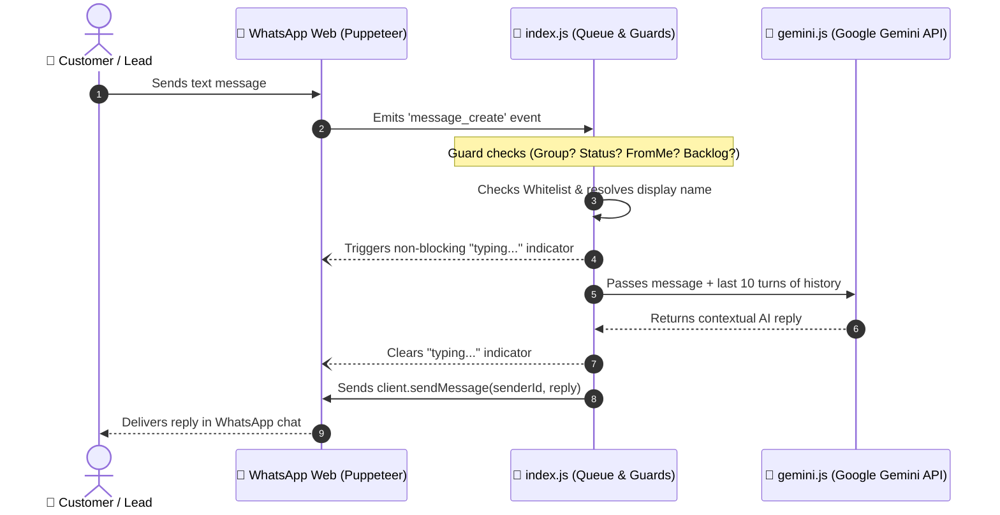

# 🤖 WhatsApp AI Auto-Responder Bot

<div align="center">

[](https://nodejs.org/)
[](https://aistudio.google.com/)
[](https://wwebjs.dev/)
[](https://opensource.org/licenses/ISC)

**An intelligent, context-aware WhatsApp customer assistant powered by Google Gemini AI and Node.js.**  
*Automate inquiries, provide 24/7 support, and maintain natural conversations without extra WhatsApp Business API costs.*

[Quick Start](#-quick-start) • [Features](#-key-features) • [Configuration](#-configuration) • [247-Hosting](#-running-247-in-production) • [FAQ](#-troubleshooting--faq)

</div>

---

## 📑 Table of Contents
- [✨ Key Features](#-key-features)
- [🔄 How It Works](#-how-it-works)
- [📋 Prerequisites](#-prerequisites)
- [🚀 Quick Start](#-quick-start)
- [⚙️ Configuration](#-configuration)
- [🤖 Business Persona Templates](#-business-persona-templates)
- [⚡ Gemini API Free Tier Quota](#-gemini-api-free-tier-limits)
- [🖥️ Running 24/7 in Production](#-running-247-in-production)
- [📂 Project Structure](#-project-structure)
- [🛠️ Troubleshooting & FAQ](#-troubleshooting--faq)
- [📄 License](#-license)

---

## ✨ Key Features

- **🧠 Google Gemini 2.5 Flash**: Lightning-fast, intelligent, and cost-efficient responses powered by Google's latest multimodal LLMs.
- **💬 Multi-Turn Conversation Memory**: Retains conversation history for the last 10 exchanges per contact to understand context and follow-up inquiries.
- **🛡️ Anti-Loop & Developer Self-Testing**: Built-in echo detection allowing developers to test queries via WhatsApp's *"Message yourself"* (Note to Self) without triggering infinite self-reply loops.
- **⚡ Zero-Hang Async Pipeline**: Non-blocking typing indicators and synchronous sender resolution ensure incoming messages are never delayed or frozen by browser evaluation calls.
- **🎯 Flexible Audience Targeting**:
  - `ALL`: Auto-reply to every incoming 1-on-1 customer message.
  - `WHITELIST`: Restrict auto-replies exclusively to numbers specified in `contacts.json`.
- **🕒 Clock Skew & Backlog Filter**: Rejects old messages synced during startup while maintaining a safe window to prevent clock drift from discarding real-time messages.
- **💾 Session Persistence**: Scan the QR code once with `LocalAuth`; authentication persists across server restarts.
- **🚫 Spam & Group Protection**: Automatically ignores group chats, broadcast channels, newsletter updates, status stories, and media-only messages without captions.

---

## 🔄 How It Works



---

## 📋 Prerequisites

Before setting up the project, ensure you have:
1. **Node.js**: `v18.0.0` or higher installed ([Download Node.js](https://nodejs.org/)).
2. **Google Gemini API Key**: Free API key from [Google AI Studio](https://aistudio.google.com/).
3. **WhatsApp Account**: A phone with WhatsApp installed to link the bot.

---

## 🚀 Quick Start

### 1. Clone & Install Dependencies

```bash
git clone https://github.com/your-username/whatsapp-bot.git
cd whatsapp-bot
npm install
```

### 2. Configure Environment Variables

Duplicate the example environment file:
```bash
# Windows PowerShell
Copy-Item .env.example .env

# Linux / macOS
cp .env.example .env
```

Open `.env` and add your **Gemini API Key**:
```env
GEMINI_API_KEY=AIzaSyYourGeminiApiKeyHere
GEMINI_MODEL=gemini-2.5-flash
AUTO_REPLY_MODE=all
```

### 3. Verify Gemini Connection

Test your API key and prompt connectivity before launching WhatsApp:
```bash
node test-gemini.js
```
*(If successful, you will see a green `✅ SUCCESS! Gemini responded:` confirmation in your terminal).*

### 4. Start the WhatsApp Bot

```bash
npm start
```

1. A **QR Code** will be generated in your terminal.
2. Open WhatsApp on your phone:
   * **Android**: Tap `⋮` (three dots) > **Linked Devices** > **Link a Device**.
   * **iOS**: Go to **Settings** > **Linked Devices** > **Link a Device**.
3. Scan the terminal QR code.
4. Once connected, the console will display:
   ```text
   =============================================================================
   WhatsApp Bot is ACTIVE and listening for messages!
   Connected Account: Abhishek Furniture (919999999999@c.us)
   Auto-Reply Mode: ALL
   =============================================================================
   ```
5. Test it by sending a message from another phone or to your own number via **"Message yourself"**!

---

## ⚙️ Configuration

All bot behaviors can be customized via `.env` and `contacts.json`:

### Environment Variables (`.env`)

| Variable | Default Value | Description |
| :--- | :--- | :--- |
| `GEMINI_API_KEY` | *(Required)* | Your Google Gemini API key from Google AI Studio. |
| `GEMINI_MODEL` | `gemini-2.5-flash` | Gemini model variant (`gemini-2.5-flash`, `gemini-1.5-flash`, `gemini-2.0-flash`). |
| `AUTO_REPLY_MODE` | `all` | Mode selection: `all` (reply to all direct chats) or `whitelist` (only reply to numbers in `contacts.json`). |
| `BOT_PERSONA` | *Helpful assistant* | System prompt defining the bot's identity, guidelines, tone, and knowledge base. |

<details>
<summary><b>🔍 Whitelist Mode Setup (Click to expand)</b></summary>

If you want the bot to reply **only** to specific clients, set `AUTO_REPLY_MODE=whitelist` in your `.env` file and populate `contacts.json`:

```json
[
  "+91 99999-88888",
  "1234567890",
  "919876543210@c.us",
  "447123456789@c.us"
]
```
> The bot automatically strips spaces, hyphens, and plus signs, normalizing all entries to standard WhatsApp format.
</details>

---

## 🤖 Business Persona Templates

You can easily adapt the bot to any business by customizing the `BOT_PERSONA` variable in `.env`.

<details>
<summary><b>🛋️ Furniture & Home Decor (Default Template)</b></summary>

```env
BOT_PERSONA="You are the official AI assistant for Abhishek Furniture. Welcome customers warmly. Provide helpful details about furniture types, sofa sets, dining tables, custom woodwork, prices, delivery, and store timings. Answer concisely, politely, and communicate in English or Hindi/Hinglish based on the customer's language."
```
</details>

<details>
<summary><b>🍕 Restaurant & Food Delivery</b></summary>

```env
BOT_PERSONA="You are the friendly customer concierge for Bella Italia Pizzeria. Answer inquiries about our menu, today's specials, dietary options (vegan, gluten-free), opening hours (11 AM - 11 PM), and table reservations. Keep answers short, welcoming, and appetizing."
```
</details>

<details>
<summary><b>🏥 Clinic / Healthcare Appointment Desk</b></summary>

```env
BOT_PERSONA="You are the medical receptionist assistant for Apex Dental Clinic. Help patients check clinic hours (Mon-Sat 10 AM - 7 PM), available dental services, consultation fees, and emergency contacts. Always advise patients that medical advice must be confirmed with the doctor in person."
```
</details>

<details>
<summary><b>🛍️ E-Commerce / Boutique Store</b></summary>

```env
BOT_PERSONA="You are the digital support assistant for Urban Vogue Clothing. Assist shoppers with order tracking, return policies (7-day hassle-free returns), size charts, and ongoing discounts. Be polite, trendy, and concise."
```
</details>

---

## ⚡ Gemini API Free Tier Limits

Google AI Studio provides a free tier for Gemini models:

| Metric | Free Tier Quota | Impact on Bot |
| :--- | :--- | :--- |
| **Requests Per Day (RPD)** | **1,500 requests/day** | Up to **1,500 customer replies daily** for free (resets at 12:30 PM IST / 00:00 PST). |
| **Requests Per Minute (RPM)** | **15 requests/min** | Up to **15 replies/minute** concurrently (~1 message every 4 seconds). |
| **Tokens Per Minute (TPM)** | **1,000,000 tokens/min** | ~750,000 words per minute. Won't be exhausted by typical WhatsApp conversations. |

> [!TIP]
> **Need higher volume?** Enabling Pay-As-You-Go on Google AI Studio expands the limits to **2,000 RPM** at just ~$0.075 per million tokens (less than ₹1 for every ~500 conversations).

---

## 🖥️ Running 24/7 in Production

To keep your WhatsApp bot replying even when your personal computer is turned off or your terminal is closed:

### Method 1: Background Process via PM2 (Local PC or VPS)

1. Install PM2:
   ```bash
   npm install -g pm2
   ```
2. Start the bot:
   ```bash
   pm2 start index.js --name "whatsapp-bot"
   ```
3. Useful PM2 commands:
   ```bash
   pm2 logs whatsapp-bot    # View live conversation logs
   pm2 status               # Check uptime & memory
   pm2 restart whatsapp-bot # Restart the bot
   pm2 stop whatsapp-bot    # Stop the bot
   ```

### Method 2: Deploy to a Cloud VPS (AWS, DigitalOcean, Oracle)

1. Provision an Ubuntu VPS with **at least 1 GB RAM** (e.g., Oracle Cloud Free Tier, DigitalOcean $4/mo, or AWS EC2 `t3.small`).
2. Install Node.js 18+ and Chromium system dependencies:
   ```bash
   sudo apt update && sudo apt install -y curl git
   curl -fsSL https://deb.nodesource.com/setup_20.x | sudo -E bash -
   sudo apt install -y nodejs libgbm-dev libnss3 libatk-bridge2.0-0 libcups2 libdrm2 libxcomposite1 libxdamage1 libxrandr2 libasound2
   ```
3. Clone your repository, run `npm install`, configure `.env`, and start with `pm2`.

---

## 📂 Project Structure

```text
├── .env                      # Environment configuration & API credentials
├── .env.example              # Template for environment variables
├── .wwebjs_auth/             # (Auto-generated) Local session credentials
├── config.js                 # Configuration loader and contact normalization
├── contacts.json             # Whitelist numbers for auto-reply restriction
├── gemini.js                 # Gemini API integration & chat history memory
├── index.js                  # Main WhatsApp client, event dispatcher & queue
├── package.json              # Project dependencies and startup scripts
├── README.md                 # Project documentation
└── test-gemini.js            # Standalone Gemini API test utility
```

---

## 🛠️ Troubleshooting & FAQ

<details>
<summary><b>1. Error: EBUSY: resource busy or locked, unlink 'lockfile'</b></summary>

**Cause:** On Windows, Chromium holds a filesystem lock on the session cache while exiting or when previous processes terminated abruptly.  
**Fix:**
```powershell
# Stop all Node processes, then remove stale session folders:
Remove-Item -Recurse -Force .wwebjs_auth, .wwebjs_cache
npm start
```
*Our codebase includes an integrated patch in `LocalAuth.js` to catch and suppress this error automatically.*
</details>

<details>
<summary><b>2. Bot binds successfully but does not reply to messages</b></summary>

**Checklist:**
- Ensure you are sending **text messages** (media-only messages without captions are skipped).
- If `AUTO_REPLY_MODE=whitelist`, verify that the sender's phone number is added to `contacts.json`.
- Test if your Gemini API key is valid by running `node test-gemini.js`.
- If testing from the same linked phone, use WhatsApp's **"Message yourself"** chat.
</details>

<details>
<summary><b>3. How can I reset the conversation memory for a user?</b></summary>

Conversation history is stored in memory (`chatHistories` map in `gemini.js`) and keeps the last 10 exchanges. Restarting the bot resets all conversational memory.
</details>

<details>
<summary><b>4. Can I use the bot in WhatsApp Groups?</b></summary>

By default, group messages (`@g.us`) are ignored to prevent spamming and unnecessary API costs. To enable group replies, remove the group guard clause in [index.js](file:///C:/Users/Lenovo/OneDrive/Desktop/projects/whatsapp-bot-new/index.js).
</details>

---

## 📄 License

This project is licensed under the [ISC License](https://opensource.org/licenses/ISC). Free for personal and commercial usage.

---

<div align="center">
Made with ❤️ using Node.js & Google Gemini.
</div>
